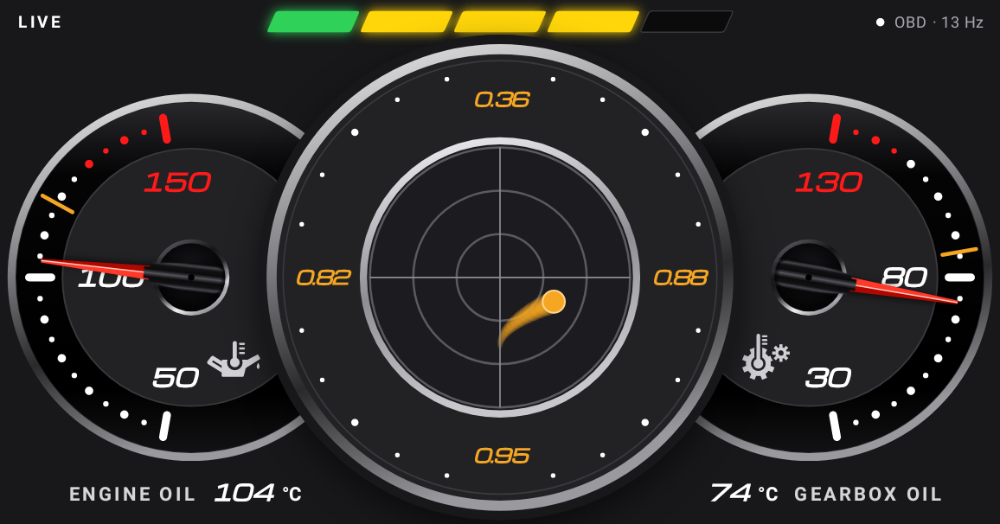
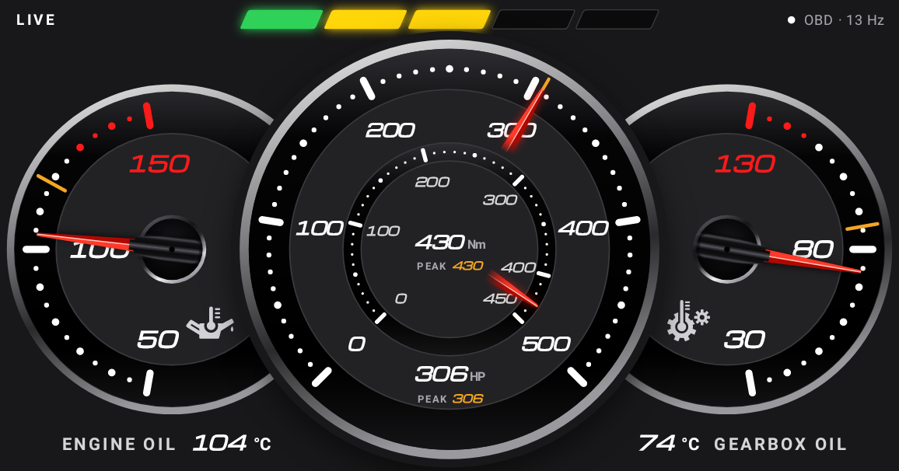
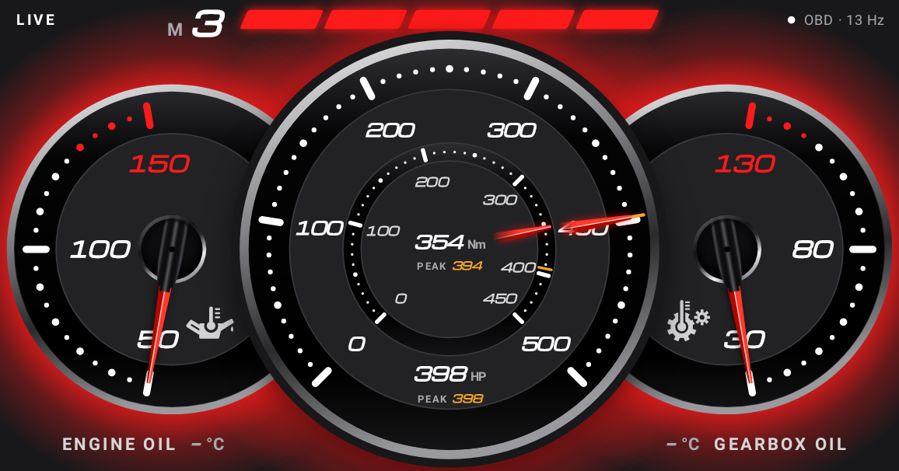
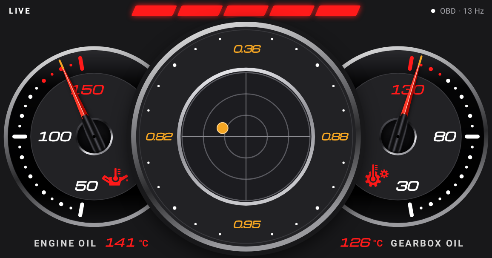
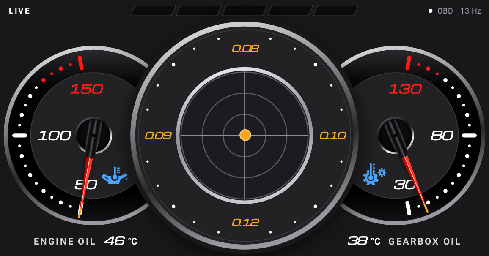
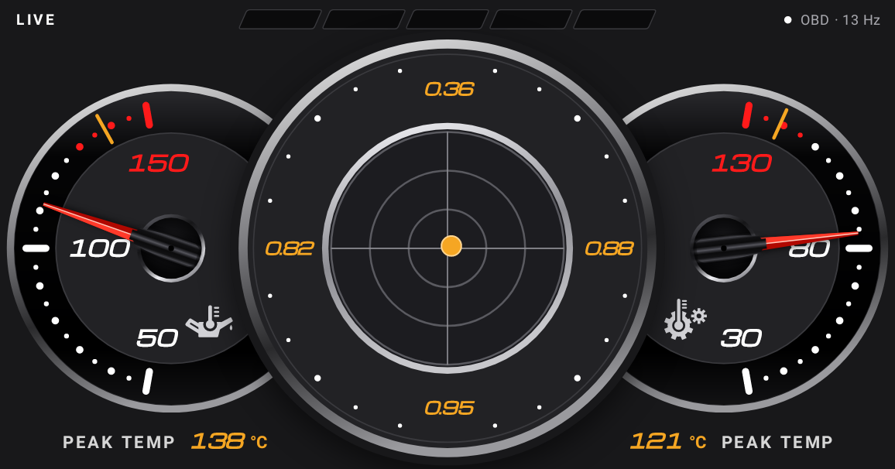
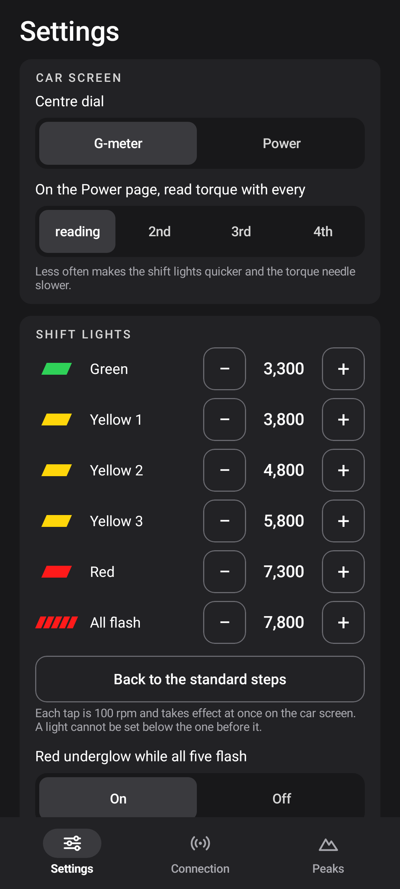
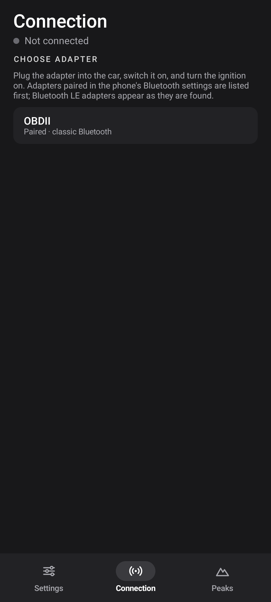
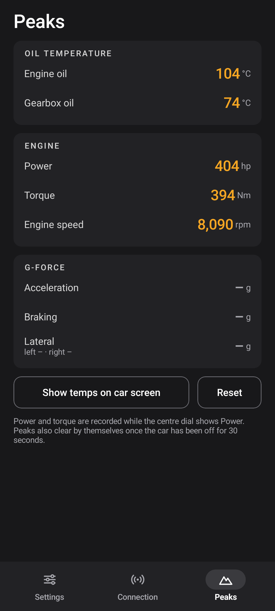

# RS Monitor

An Android Auto gauge app for an Audi RS5 (B8.5), read over a Bluetooth OBD2 adapter. On the
car screen it shows:

- Engine oil temperature and gearbox (S tronic) oil temperature, each with its peak
- A centre dial that switches between a G-meter and engine power and torque
- A five-stage shift light, with a red glow from behind the dials at the shift point
- The gear

Status: **in use in the car.** The app connects to the adapter and reads everything it shows
from the car: both oil temperatures (checked against the car), and engine speed, engine torque
and the gear from the gearbox. The G-meter runs from the phone's motion sensor once
calibrated. Still open: S shows as D, torque reads a little below Audi's figures, and how
fast the screen updates is set by the adapter's Bluetooth link (see "Open questions").

## What it looks like

**The car screen**

| G-meter page | Power and torque page |
|---|---|
|  |  |
| **At the shift point** | **Both oils in the red zone** |
|  |  |
| **Cold start** | **Peak temperatures called up** |
|  |  |

**The phone app**

| Settings | Connection | Peaks |
|---|---|---|
|  |  |  |

Settings is longer than a phone screen: [the whole of it](https://raw.githubusercontent.com/AndiS2112/RSMonitor/previews/phone-settings-full.png).

These pictures are not mockups. Every build draws the car screen and the phone's three tabs
with the app's own code and publishes the files on the `previews` branch, and the pictures
above are loaded from there. They show the most recent build of any branch, with sample
readings.

The first design, an 800×480 mockup made before any code, is kept under `design/` (see "What
is in this repo"). The app's screen has moved on from it.

## The app

**What it does**

- Finds the OBD adapter, over classic Bluetooth or Bluetooth LE, and sets it up for the car.
- The phone app has three sections on a bottom bar: **Settings**, **Connection** and
  **Peaks** (see "The phone app" below).
- Console on the phone: type a command, see the reply, switch between the engine unit (7E0)
  and the gearbox unit (7E1).
- Live engine speed, as fast as the adapter allows.
- Android Auto gauge screen, drawn from the design: the three gauges and the shift lights.
  The shift lights, the G-meter and both oil gauges have live data.
- G-meter from the phone's motion sensor, with peak numbers and a three-second tail behind the dot.
- Peak engine-oil and gearbox-oil temperature: an amber hand on each scale, and the exact
  figures called up on the car screen from the phone.
- The controls are on the phone: live data on/off, centre dial page, shift-light speeds,
  G-meter calibration, peak call-out. The car screen keeps one icon button, which Android
  Auto requires.
- Power and torque page for the centre dial, with engine torque as the gearbox reports it.
- The gear beside the shift lights: P, R, N, D or M (gears chosen by hand) and the gear
  number.

**Gauge screen layout in the app**

- The three dials run from edge to edge of the car screen. The design box has the shape of
  the screen area (844 × 442 units for the 1156 × 606 px the head unit gives the app), and
  the dials are drawn 22% larger than their first size.
- No title. The top row holds LIVE on the left, the five shift lights in the middle and the
  adapter status on the right. The shift lights are bars leaning to the right, side by side,
  together as wide as the centre dial below them.
- Oil gauges are tucked behind the centre dial. The icon sits below the hub, on the centre
  dial's side of the lowest numeral.
- The icons: engine oil is an oil can with its spout and drip to the right; gearbox oil is
  a solid gear with a small gear beside it. Each holds a thermometer: the bulb sits in the
  can or the gear with a gap around it, and the stem and three marks, facing right, stand
  above.
- While all five shift lights flash, a red glow shows from behind the three dials: strongest
  at their rims and fading out over about 100 screen pixels. It comes up in under a tenth of
  a second, pulses four times a second in step with the lights without going fully dark
  (down to 30% between flashes), and dies away over about a fifth of a second after the
  shift.
  It can be switched off on the phone, under Settings, Shift lights; the choice is remembered.
- Every figure on the car screen is set in Michroma, a wide, squared font close to the
  figures on the car's own dials. It is bundled with the app (`res/font/michroma.ttf`, SIL
  Open Font License, the licence text is in `assets/licenses`). Michroma has one light,
  upright cut, so the figures are leaned over by a quarter of their height and drawn with
  an edge that thickens their strokes by about half. They are drawn at 72% of the size the
  old figures had, since Michroma is that much wider. Labels and units stay in the phone's
  own font.
- The G-meter's dot for the current reading is small (7.7 units in radius) and solid amber
  with a fine lighter edge. It pulls an amber tail: its path over the last three seconds,
  as wide as the dot where it leaves it, thinning and fading to nothing. There is no peak
  outline any more; the four peak numbers carry the peaks.
- **No text notices.** Each oil's icon carries its state instead: grey at operating
  temperature, blue below it, and red, pulsing three times a second, in the red zone. The
  temperature number under the gauge also turns red in the red zone.
- Each oil scale covers 160°: the lowest numeral is 10° short of straight down, the middle
  numeral is level with the hub, and the highest is 10° short of straight up.
- There is a mark every 5 °C: a bar at each numeral, a large dot at the other tens and a
  small dot at the fives.
- Engine oil: scale 50 – 100 – 150 °C, blue below 80 °C, red zone from 130 °C.
- Gearbox oil: scale 30 – 80 – 130 °C, blue below 50 °C, red zone from 115 °C.
- Those four limits are the standard ones. Each can be moved on the phone in 5 °C steps,
  also while driving, and is remembered: anywhere on its scale, with "cold" at least 5 °C
  below "hot".
- Whether the adapter is connected and live data is on shows only in the top corners
  ("OBD off", "PAUSED").
- Peak oil temperature: a thin amber hand marks the peak on each scale at all times. The
  exact figure is hidden until it is asked for: **Show temps on car screen**, under Peaks on
  the phone, calls it up for ten seconds (tapping again puts it away sooner), and the row under each gauge
  then reads "PEAK TEMP" with the peak in amber in place of the current reading. The peak
  is never shown below the current reading.
- Until the G-meter is calibrated its plot says so, and its four peak numbers show a dash.

**Gear**

The selector position and gear are drawn just left of the shift lights: a small mode letter
and a large gear number ("D 4", "M 3"), or one large letter for P, R and N. It comes from
the gearbox twice a second while live. M means the gears are being chosen by hand; S shows
as D, because the values found so far do not tell the two apart.

**Power and torque**

The centre dial's page, G-meter or power and torque, is chosen on the phone (**Centre
dial**), and the choice is remembered. The car screen's one icon button switches it too.

- Two rings in one dial, each with a 270° scale open at the bottom: power on the outer ring
  (0–500 HP), torque on the inner ring (0–450 Nm). The car makes 450 PS at 8,250 rpm and
  430 Nm from 4,000 to 6,000 rpm.
- Each ring has its own needle, solid at its scale and fading out at its root. The power
  needle starts just outside the torque gauge, so it never lies over it.
- The torque reading and its peak sit in the middle of the torque ring; the power reading
  and its peak sit in the open bottom of the power ring. Peaks are also marked in amber on
  each ring. They clear when the car is switched off.
- HP is metric horsepower (PS): torque in Nm × rpm ÷ 7023.5.
- Torque is the engine computer's own calculated figure, not a measurement, as the gearbox
  receives it (gearbox ID `2002`): what reaches the clutch, the kind of figure Audi quotes.
  The dials start at zero, so engine braking shows as none.
- While this page shows, torque is asked from the gearbox straight after engine speed. Each
  torque reading costs one engine-speed reading, so the phone has a switch (Settings, **Car screen**
  panel) for how often torque is read: with every engine-speed reading, or every second,
  third or fourth. It can be changed while driving, and the panel shows both rates. On the
  G-meter page torque is not read at all.

**G-meter**

The phone can lie any way round (it lives in the cupholder), so it has to be calibrated each
time it is put down. On the phone screen, in the G-METER panel:

1. Wedge the phone so it cannot slide, with the car parked, and tap **Calibrate**. The app
   takes about three seconds to find which way is down.
2. Pull away forwards in a straight line. The first steady push (0.08 g for one second) is
   taken as "forward". The car screen shows which step it is waiting for.
3. If that pull-away was in reverse, braking will show as accelerating: tap **Swap front and
   back**.

Up on the dial is accelerating, down is braking, right is turning right. **Reset**, under
Peaks on the phone, clears every peak, the four peak g numbers included. A phone that slides or tips after calibration
gives wrong readings until it is calibrated again; a long slope shows as a small steady offset.

**When peaks reset**

- Peak G: on a new calibration, with Reset under Peaks, and when the car is switched off.
- All other peaks (oil temperatures, power, torque, engine speed): with Reset under Peaks,
  and when the car is switched off.
- "Switched off" means the car has not answered for 30 seconds, after having answered at
  least once. That covers the Bluetooth link dropping and the ignition going off while the
  adapter stays powered. The 30 seconds only count while the app is asking the car something
  (live data on, or a scan running) or the link is down.

**Getting the APK**

Every push that touches the app is built by GitHub Actions. Open the repo's Actions tab, pick
the latest "Build APK" run, and download the `rs-monitor-debug-apk` artifact. Unzip it and
install `app-debug.apk` on the phone, with UnknownAuto as before. Every build is signed with
the same key (`signing/debug.keystore`) and carries a higher build number than the last, so
a new build installs over the old one: no uninstall, and the settings, the calibration and
the chosen adapter are kept. Builds from before this key was added were each signed with a
key of their own, so the first build with it needs one last uninstall.

The key is a debug key and the repo is public, so it is no proof of who built an APK:
install only APKs from this repo's own Actions runs.

To build on a computer instead, open the repo in Android Studio.

**First run**

1. Plug the adapter into the car, switch it on, and turn the ignition on.
2. Open RS Monitor on the phone, allow Bluetooth, and pick the adapter.
3. In the console, send `0105`. A reply containing `41 05` means the engine unit answers
   (that value is coolant temperature).
4. Switch to Gearbox and send `22 F1 90`. Any reply starting `7E9` means the adapter can aim
   a request at the gearbox unit, which is what the oil-temperature gauges depend on.
5. Turn on live engine speed and check the number against the tachometer.

**Finding the oil-temperature IDs**

Find IDs (Settings, Tools) asks the selected control unit for every data ID in a range and lists the
ones that answer, with the raw bytes and what they would mean as a temperature under the two
formulas VW-group units most often use. It only reads values. To pin an ID down, scan once
cold and once warm and look for the value that tracks the oil temperature on the dash (for
the gearbox, against a VCDS reading).

**The phone app**

- **Settings.** Car screen: which page the centre dial shows, and how often torque is read
  on the power page. Shift lights: the six speeds, each with − and + buttons. Oil temperatures:
  the cold and hot limits of both oils, each with − and + buttons. G-meter:
  Calibrate and Swap front / back. Tools: Console, Find IDs, Recorder and Speed test, each opening as
  a screen of its own with a way back.
- **Connection.** The list of adapters to choose from; once connected, the adapter with
  Disconnect, the live data switch and the live readings (engine speed, gear, both oil
  temperatures, and torque and power while they are read). The app opens here until an
  adapter is connected.
- **Peaks.** The highest engine oil and gearbox oil temperature, power, torque, engine
  speed, and acceleration, braking and lateral g (the larger of left and right, with both
  shown). Power and torque are only recorded while the centre dial shows Power, since
  torque is not read otherwise. Two buttons: show the peak temperatures on the car screen
  for ten seconds, and Reset, which clears every peak.

**Speed test**

The Speed test (Settings, Tools) shows what holds the live readings back. It sends the same
request 40 times and times each answer: a command the adapter answers by itself (`ATI`),
engine speed from the gearbox (`22 21 02`) as live data reads it, and engine speed from the
engine (`01 0C`). The first is the cost of the adapter and Bluetooth alone; a reading from
the car costs that plus the car's answer and the adapter passing it on. If the adapter alone
is most of a reading, a faster adapter will help; if it is a small part, the test cannot
tell a slow car from an adapter that is slow at passing answers on. It only reads values,
takes about ten seconds, and pauses live data while it runs. Run it with the engine idling.

**Where live data's time goes**

While live data runs, the console gets a line every ten seconds, for example
`17/s · engine speed 52 ms each (fastest 28, slowest 96) · torque 9/s at 31 ms · the rest 14% of the time`.
It shows, from a real drive, whether requests themselves are slow (the radio) or the time goes
on everything else: the other requests and the loop. The console keeps its last 200 lines.

**Recording a drive**

The Recorder (Settings, Tools) logs what the gearbox reports while the car is driven, several rows a
second: engine speed (`2102`), engine torque (`2002`), the selector (`210C`) and the two gear
candidates (`210E`, `210F`) in every row, one further ID per row in turn, and the engine's
own speed (`010C`) every tenth row as a check. It only reads values. Live data is off while
it records. Start it parked, drive, stop it parked, and share the file.

Each row is `t_ms,2102,2002,210C,210E,210F,extra,rpm_010C`, the values in hex as received,
the extra as `2142=00D4`, the engine's speed in rpm.

**On the car screen**

Installing the APK the normal way is not enough. Android Auto only shows an app built with the
Car App Library if Android has it recorded as installed from Google Play, and the "Unknown
sources" developer setting does not change that for this kind of app.

- **What works on this phone:** installing the APK with the UnknownAuto tool
  (github.com/GitMag/UnknownAuto), which uses Shizuku to record Google Play as the installer.
- **Not tried:** from a computer, `adb install -i com.android.vending app-debug.apk`.
- **The route Google documents:** a Play Console internal test track.

After installing, reconnect the phone to the car. If RS Monitor is missing, check "Customize
launcher" in Android Auto's settings on the phone.

**Code layout**

| Path | What it is |
|---|---|
| `app/src/main/java/com/rsmonitor/app/obd/` | Bluetooth links, the ELM327 command layer, reply parsing, and the shared connection |
| `app/src/main/java/com/rsmonitor/app/ui/` | The phone screen (discovery console) |
| `app/src/main/java/com/rsmonitor/app/car/` | The Android Auto screen and the shift-light rule |
| `app/src/main/java/com/rsmonitor/app/drive/` | G-force from the motion sensor, calibration, and the peaks |
| `app/src/test/` | Unit tests for reply parsing, the shift-light rule, calibration and the peaks, and a test that draws the gauge screen to PNG files |
| `.github/workflows/build.yml` | Builds and tests the app on every push |

## What is in this repo

| Path | What it is |
|---|---|
| `app/` | The Android app: the phone screens, the Android Auto gauge screen, and the adapter link |
| `app/src/test/` | Tests, and the two that draw the car screen and the phone tabs to PNG files |
| `.github/workflows/build.yml` | Builds the APK and publishes the drawn screens to the `previews` branch |
| `signing/debug.keystore` | The debug key every build is signed with, so builds install over each other |
| `design/Warmup.dc.html` | Android Auto screen at cold start, with a warm-up notice |
| `design/Main.dc.html` | Android Auto screen while driving at normal temperatures |
| `design/Hot.dc.html` | Android Auto screen with both oils in the hot zone |
| `design/Console.dc.html` | Phone screen for finding and checking the car's data IDs |
| `design/canvas.json` | Layout of the four screens on the design canvas |
| `design/preview/` | PNG previews of the four screens |
| `tools/gen_gauges.py` | Script that draws the three Android Auto screens |
| `tools/rail.html` | The left-hand Android Auto menu bar used by the script |
| `tools/render_preview.py` | Script that renders the PNG previews |

Everything under `design/` and `tools/` is the first design, from before the app existed.
The `.dc.html` files are design-canvas source. They load a `support.js` runtime that the
canvas provides, so they do not render on their own in a browser. Use the previews to look
at the design here.

To rebuild after changing the gauge script (the previews need Google Chrome installed):

```
python3 tools/gen_gauges.py design
python3 tools/render_preview.py design design/preview
```

## Design decisions

How the car screen is laid out, its scales and what each oil's icon shows are described under
"Gauge screen layout in the app" above. The first design differed: an 800×480 screen with a
title, a text notice at the bottom for cold and hot oil, and a gearbox scale of 50 to 130 °C.

**Shift light**

| Light | Colour | Comes on at |
|---|---|---|
| 1 | Green | 3,300 rpm |
| 2 | Yellow | 3,800 rpm |
| 3 | Yellow | 4,800 rpm |
| 4 | Yellow | 5,800 rpm |
| 5 | Red | 7,300 rpm |

- From 7,800 rpm all five flash red: upshift.
- These six speeds are the ones built in. Each can be moved in steps of 100 rpm under
  Settings on the phone, also while driving; the car screen follows at once and the choice
  is remembered. A light cannot be set below the one before it or above the one after it.
- Every step sits 200 rpm below its round figure (3,500, 4,000, 5,000, 6,000, 7,500, 8,000),
  to allow for the time a reading takes to reach the car screen.
- These are the steps in the app. The first design files under `design/` still use the
  earlier steps (4,000 to 8,000 rpm, flashing from 8,200).
- Lights stay on once passed, so they fill from left to right. Unlit lights show as dark sockets.
- The flash is four times a second and stops if the device asks for reduced motion.

**Look**

- Dark grey screen, charcoal dial faces, chrome rings, a black gloss band behind the dots on
  the oil gauges.
- White numerals; dots between the labelled marks, red in the hot zone.
- Red two-tone needle with a ribbed black cap in a chrome-ringed hub. In the app the cap is
  short: it ends 6 units past the hub's silver ring, so nearly all of the needle shows red.
- An icon beside each hub: oil can with thermometer, gear with thermometer.
- G-meter: rings at 0.5, 1.0 and 1.5 g, crosshair, amber dot for the current
  reading with an amber tail, four amber peak numbers.
- The first design had a plain "RS MONITOR" text header; the app has none. No manufacturer
  logos are used.
- All readings in the design are sample numbers.

**Palette and type**

| Use | Value |
|---|---|
| Screen | `#18181A` |
| Dial faces, panels | `#222225` |
| G-meter plot | `#1C1C20` |
| Hairlines | `#3A3A3E` |
| Text | `#FFFFFF`, labels `#D6D6D6`, secondary `#A8A8AE` |
| Hot zone, hot reading | `#FF1A1A` |
| Hot notice fill | `#C8101A` |
| G-meter peak numbers, "waiting" in the console | `#F5A623` |
| Shift lights | green `#2FD158`, yellow `#FFD60A`, red `#FF1A1A`, unlit `#0B0B0C` |

That early design used Saira throughout, with bold italic numbers at 112.5% width, and JetBrains
Mono for the console log. The app's car screen now sets its figures in Michroma: see above.

## How the app is built

- **Android Auto screen:** Google's Car App Library, sideloaded (not a Play Store app). The
  gauges are drawn by the app itself onto the surface Android Auto hands it, 30 times a
  second.
- **OBD link:** a Kotlin layer talking to an ELM327-type adapter over Bluetooth (LE or
  classic), sending requests to the engine unit (7E0) and the gearbox unit (7E1).
- **Shift light, power and gear:** engine speed, engine torque and the gear are all read from
  the gearbox unit, which answers faster than the engine unit. Power is worked out from
  torque and engine speed.
- **G-meter:** from the phone's motion sensor, with a calibrate step for how the phone lies
  in the car.
- **Phone app:** settings, the adapter connection and the peaks, plus the tools used to find
  and check the car's data IDs (console, Find IDs, recorder, speed test).

## Known about the car and the adapter

- **Both control units use UDS.** Checked in VCDS for engine (01) and gearbox (02). A generic
  ELM327 can therefore read both: a `22` request plus a two-byte data ID, sent to 7E0 for the
  engine and 7E1 for the gearbox.
- **Adapter:** a generic ELM327 "mini" with a power button (sold as Kungfuren OBD2 4.0). It
  must be switched on to be seen.
- **The adapter can reach both control units.** Tested in the car: the engine unit answers
  `0105` from `7E8`, and with the gearbox selected a `22 F1 90` request is answered from `7E9`.
- **How fast engine speed updates on this adapter:** 17 to 20 readings a second on the
  G-meter page and about 10 on the power page with torque read every time, measured on the
  car with everything coming from the gearbox. Before that, with engine speed asked from
  the engine alone, it was about 13.
- **Gearbox oil temperature is data ID `2104` on the gearbox control unit:** send `22 21 04`
  to 7E1. The answer carries one byte; the temperature in °C is that byte minus 40.
  Confirmed on the car: 19 °C after standing for days with 18 °C outside (`62 21 04 3B`),
  and 20 °C at the next cold start. The app asks for it every three seconds while live.
- **How the gearbox oil behaves:** it warms far more slowly than the engine (62 °C after
  20 minutes, with the engine oil at 98 °C). Warm, it sits at 70 to 75 °C on the move and
  climbs to about 85 °C standing still. Its gauge and standard limits are set for that: 50 °C counts
  as operating temperature and the red zone starts at 115 °C.
- **Engine oil temperature is data ID `11BD` on the engine control unit:** send `22 11 BD`
  to 7E0. The answer carries two bytes, in tenths of a kelvin: °C = value ÷ 10 − 273.15.
  Confirmed on the car: the gauge matches the oil temperature on the instrument cluster.
  Other temperatures seen in the two scans but not identified: `1291` (16.5 °C cold, 103.5 °C
  warm), `129A` (104.2 °C warm), `1063` (105.7 °C warm), and `128A` (36 °C in the cold scan,
  100.5 °C warm), which looks like coolant.
- **What the gearbox control unit (7E1) reports,** from scans of 2000–22FF in P, R and D
  (brake held) on a warming engine, and VCDS readings taken alongside. All of these answer
  without opening a diagnostic session.

  | ID | Bytes | Meaning | How sure |
  |---|---|---|---|
  | `2002` | 2 | Engine torque as the gearbox receives it, in Nm. 4–5 in P, 14 in D; 394 on full throttle at 6,100 rpm. Below zero it reads 3277 + torque: `0C 9B` is −50 Nm, and the 3181 with the engine stopped is −96 Nm. | Confirmed: equals the torque the clutch is asked to carry |
  | `2102` | 2 | Engine speed in quarter-rpm. | Confirmed against `010C` up to 8,090 rpm |
  | `2104` | 1 | Oil temperature, byte − 40 °C. | Confirmed |
  | `210C` | 1 | Selector: 0 P, 1 R, 2 N, 3 D. S and manual also read 3. | Confirmed |
  | `210E` | 1 | The selector again, doubled: 0, 2, 4, 6. | Confirmed |
  | `210F` | 1 | The engaged gear: 1 reverse, 2 nothing engaged (P, N), 3 to 9 gears 1 to 7. | Confirmed on a drive through all seven |
  | `210B` | 1 | `0B` in P, R, N, D and S; `03` while the gears are chosen by hand. | Seen on two drives |
  | `2111` | 2 | 1 while the gears are chosen by hand, otherwise 0. | Seen on two drives |
  | `2103` | 2 | Rises with road speed; engine speed ÷ this is steady in each gear (2.4 in second, 0.68 in seventh). | Likely output speed |
  | `2105` | 2 | Follows the gear ratio: 161 in first, 97 in second, 26 in seventh. | Seen |
  | `2112`, `2113` | 1 | 1 in P, 0 in R and D. | Seen |
  | `214E` | 1 | 1 in P, 5 in R and D. | Seen |
  | `2142`, `2143` | 2 | Specified torque of clutch 1 and clutch 2, signed, 0.05 Nm per count; `D8 F0` (−500.00) means open. Clutch 1 carries D, clutch 2 carries R. | Matches VCDS |
  | `214C`, `214D` | 2 | 17.1 in D (clutch 1) and 16.1 in R (clutch 2) at 0.05 per count; VCDS "Torque transmitting function" read 16.1 in D. | Likely |
  | `2144`–`214B` | 2 | Eight values around 5000–8500 that move between P, R and D. Not identified. | Open |

- **Two different "engine torques".** The engine control unit's own "Engine torque" in VCDS
  read 70–80 Nm at a cold idle in P: what combustion produces before the engine's own
  losses. The gearbox's "Engine torque-Data" read 11 Nm at the same moment (1 Nm warm) and
  about 14 Nm more in D with the brake held: what reaches the clutch. The second is the
  output figure, the kind Audi quotes, so it is the one for the power page. With the
  ignition on and the engine off it reads 3181 Nm, a placeholder.
- **The adapter sends at most seven bytes in a request,** so no more than three data IDs can
  be asked for at once.
- **How this engine stores temperatures:** one-byte values are raw × 0.75 − 48 °C; two-byte
  values are tenths of a kelvin.
- **The engine does not offer the standard torque values.** `0163` is refused with
  `7F 01 12`. Torque will have to come from one of Audi's own data IDs.
- **Engine data IDs tried and refused:** `22 20 A1` and `22 F4 5C`. A scan of engine IDs
  2000–20FF found only `2096 = FF`.
- **The app shows on the car screen** once it is installed so that Android records Google Play
  as the installer.
- **The car gives the app a 1180×630 px surface at 166 dpi, of which 1156×606 is usable.**
  Android Auto's menu bar runs along the bottom, outside that area. The panel itself is the
  800×480 MMI 3G+ screen; the Android Auto box scales the picture down to it. The gauge screen
  scales the design to whatever area it is given, so it fits by height.

## Open questions

1. **Whether the adapter is classic Bluetooth or Bluetooth LE.** The app handles both, so this
   only matters for which entry to pick in the adapter list.
2. **Whether three pulses a second reads well on the car screen**, which repaints about 30
   times a second.
3. **Whether the motion sensor keeps reporting with the phone's screen off** while Android
   Auto is running. Not yet checked in the car.
4. **Whether the gauge screen stays smooth** now that the G-meter repaints it about 16 times
   a second.
5. **Engine torque reads below Audi's figures.** On one pull in second and third the peaks
   were 394 Nm (6,100 rpm) and about 404 PS (351 Nm at 8,090 rpm), against 430 Nm and
   450 PS. Whether that is the engine, the conditions, or throttle not fully open for long
   enough is not known.
6. **S cannot be told from D** with the values found so far, so S shows as D. Finding it
   means scanning a wider range of gearbox IDs once in D and once in S.
7. **How fast the screen updates.** Measured on the car with the phone's Speed test and the
   console's "live" lines. With this adapter on Bluetooth LE one request takes about 30 ms
   parked and 30 to 45 ms on the move: Android gives a Bluetooth LE link a turn every 11 to
   15 ms, and a question and its answer need two turns. The gearbox itself answers within
   that. Live data therefore carries about 27 requests a second in all; on the Power page,
   with torque on every second reading, that is 14 to 16 engine-speed readings a second.
   Classic Bluetooth on the same adapter is slower and erratic (about 40 to 50 ms). The
   gearbox refuses to send a reading repeatedly by itself (service `2A` answers `7F 2A 11`).
   What is left is a faster adapter on classic Bluetooth; not yet tried.
8. **The car screen's buttons.** Live data on/off and the centre dial's page are on the
   phone. Android Auto does not allow this kind of screen with no button at all, so one icon
   button (switch page) remains; it should show only for about ten seconds after the screen
   is touched. Android Auto also holds a strip at the top of the screen back for buttons;
   the gauges now paint over it. To check in the car: that the gauges fill the height, and
   that the button does go away. The phone's Centre dial panel shows the screen area
   Android Auto reports.
9. **How far the shift light lags the engine.** Each reading goes adapter → Bluetooth → phone →
   Android Auto → car screen. In a low gear the revs can climb several hundred rpm in that
   time, so the lights may need to come on earlier than the figures above. This has to be
   measured on the car.
