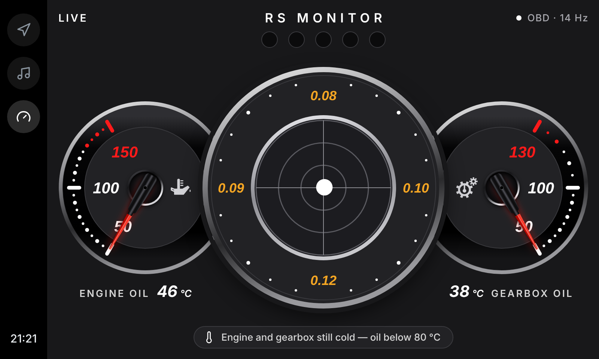
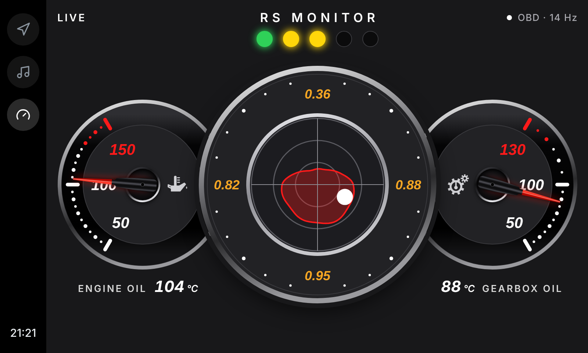
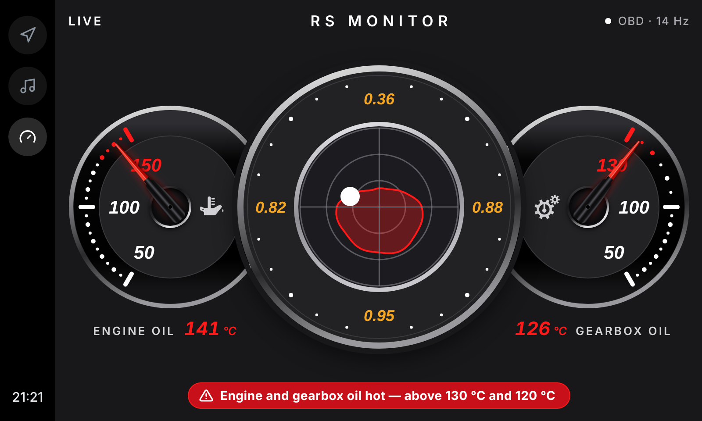
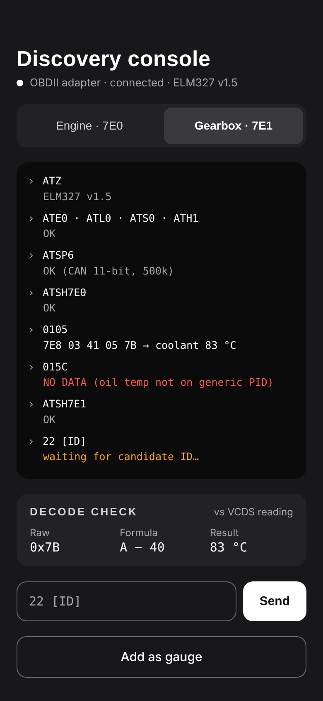

# RS Monitor

An Android Auto gauge app for an Audi RS5 (B8.5), read over a generic Bluetooth OBD2 adapter.
It shows three things on the car screen:

- Engine oil temperature
- Gearbox (S tronic) oil temperature
- A G-meter with a peak trace
- Engine power and torque (the centre dial switches between this and the G-meter)
- A five-stage shift light

Status: **design done, app partly built.** In the car, the app connects to the adapter,
reaches the engine and gearbox, and shows on Android Auto with live engine speed. The G-meter
runs from the phone's motion sensor once calibrated. Both oil temperatures are read from
the car and have been checked against it. Engine torque and the gear have no data yet:
their data IDs on this car are still being looked for.

## The design

| Cold start | Driving | Hot |
|---|---|---|
|  |  |  |

The phone screen for finding and checking the car's data IDs:



The previews are rendered without the web font, so the lettering falls back to a local font.
On the design canvas the numbers and labels are set in Saira.

These three images are the earlier 800×480 design. The app's screen has since moved on (see
"Gauge screen layout in the app" below); every build draws the current screen to PNG files,
published on the `previews` branch.

## The app (milestone 1)

**What it does**

- Finds the OBD adapter, over classic Bluetooth or Bluetooth LE, and sets it up for the car.
- Discovery console on the phone: type a command, see the reply, switch between the engine
  unit (7E0) and the gearbox unit (7E1).
- Live engine speed, read from the engine unit as fast as the adapter allows.
- Android Auto gauge screen, drawn from the design: the three gauges and the shift lights.
  The shift lights, the G-meter and both oil gauges have live data.
- G-meter from the phone's motion sensor, with peak numbers and a peak outline.
- Peak engine-oil and gearbox-oil temperature: an amber hand on each scale, and the exact
  figures called up on the car screen from the phone.
- The controls are on the phone: live data on/off, centre dial page, G-meter calibration,
  Peak Temp. The car screen keeps one icon button, which Android Auto requires.
- Power and torque page for the centre dial, with engine torque as the gearbox reports it.
- The gear beside the shift lights: P, R, N, D or M (gears chosen by hand) and the gear
  number.

**Gauge screen layout in the app**

- The three dials run from edge to edge of the car screen. The design box has the shape of
  the screen area (844 × 442 units for the 1156 × 606 px the head unit gives the app), and
  the dials are drawn 22% larger than their first size.
- No title. The top row holds LIVE on the left, the five shift lights in the middle and the
  adapter status on the right. The shift lights are bars leaning to the right, side by side,
  together as wide as the centre dial below them.
- Oil gauges are tucked behind the centre dial. The icon sits below the hub, on the centre
  dial's side of the lowest numeral.
- The icons: engine oil is an oil can with its spout and drip to the right; gearbox oil is
  a solid gear with a small gear beside it. Each holds a thermometer: the bulb sits in the
  can or the gear with a gap around it, and the stem and three marks, facing right, stand
  above.
- The G-meter's dot for the current reading is small (7.7 units in radius) and see-through
  with a fine solid edge, so the peak outline shows under it.
- **No text notices.** Each oil's icon carries its state instead: grey at operating
  temperature, blue below it, and red, pulsing three times a second, in the red zone. The
  temperature number under the gauge also turns red in the red zone.
- Each oil scale covers 160°: the lowest numeral is 10° short of straight down, the middle
  numeral is level with the hub, and the highest is 10° short of straight up.
- There is a mark every 5 °C: a bar at each numeral, a large dot at the other tens and a
  small dot at the fives.
- Engine oil: scale 50 – 100 – 150 °C, blue below 80 °C, red zone from 130 °C.
- Gearbox oil: scale 30 – 80 – 130 °C, blue below 50 °C, red zone from 115 °C.
- Whether the adapter is connected and live data is on shows only in the top corners
  ("OBD off", "PAUSED").
- Peak oil temperature: a thin amber hand marks the peak on each scale at all times. The
  exact figure is hidden until it is asked for: the **Peak Temp** button on the phone calls
  it up for ten seconds (tapping again puts it away sooner), and the row under each gauge
  then reads "PEAK TEMP" with the peak in amber in place of the current reading. The peak
  is never shown below the current reading.
- Until the G-meter is calibrated its plot says so, and its four peak numbers show a dash.

**Gear**

The selector position and gear are drawn just left of the shift lights: a small mode letter
and a large gear number ("D 4", "M 3"), or one large letter for P, R and N. It comes from
the gearbox twice a second while live. M means the gears are being chosen by hand; S shows
as D, because the values found so far do not tell the two apart.

**Power and torque**

The centre dial's page, G-meter or power and torque, is chosen on the phone (**Centre
dial**), and the choice is remembered. The car screen's one icon button switches it too.

- Two rings in one dial, each with a 270° scale open at the bottom: power on the outer ring
  (0–480 HP), torque on the inner ring (0–450 Nm). The car makes 450 PS at 8,250 rpm and
  430 Nm from 4,000 to 6,000 rpm.
- Each ring has its own needle, solid at its scale and fading out towards the middle.
- The torque reading and its peak sit in the middle of the torque ring; the power reading
  and its peak sit in the open bottom of the power ring. Peaks are also marked in amber on
  each ring. They clear when the car is switched off.
- HP is metric horsepower (PS): torque in Nm × rpm ÷ 7023.5.
- Torque is the engine computer's own calculated figure, not a measurement, as the gearbox
  receives it (gearbox ID `2002`): what reaches the clutch, the kind of figure Audi quotes.
  The dials start at zero, so engine braking shows as none.
- While this page shows, engine speed, torque and the gear are asked from the gearbox in one
  request. On the G-meter page torque is not read, which keeps the shift lights faster.

**G-meter**

The phone can lie any way round (it lives in the cupholder), so it has to be calibrated each
time it is put down. On the phone screen, in the G-METER panel:

1. Wedge the phone so it cannot slide, with the car parked, and tap **Calibrate**. The app
   takes about three seconds to find which way is down.
2. Pull away forwards in a straight line. The first steady push (0.08 g for one second) is
   taken as "forward". The car screen shows which step it is waiting for.
3. If that pull-away was in reverse, braking will show as accelerating: tap **Swap front and
   back**.

Up on the dial is accelerating, down is braking, right is turning right. **Reset peak G**
clears the four peak numbers and the outline. A phone that slides or tips after calibration
gives wrong readings until it is calibrated again; a long slope shows as a small steady offset.

**When peaks reset**

- Peak G: with the Reset peak G button, on a new calibration, and when the car is switched off.
- Peak oil temperatures: when the car is switched off.
- "Switched off" means the car has not answered for 30 seconds, after having answered at
  least once. That covers the Bluetooth link dropping and the ignition going off while the
  adapter stays powered. The 30 seconds only count while the app is asking the car something
  (live data on, or a scan running) or the link is down.

**Getting the APK**

Every push that touches the app is built by GitHub Actions. Open the repo's Actions tab, pick
the latest "Build APK" run, and download the `rs-monitor-debug-apk` artifact. Unzip it and
install `app-debug.apk` on the phone. Each build is signed with a fresh debug key, so uninstall
the previous build before installing a new one.

To build on a computer instead, open the repo in Android Studio.

**First run**

1. Plug the adapter into the car, switch it on, and turn the ignition on.
2. Open RS Monitor on the phone, allow Bluetooth, and pick the adapter.
3. In the console, send `0105`. A reply containing `41 05` means the engine unit answers
   (that value is coolant temperature).
4. Switch to Gearbox and send `22 F1 90`. Any reply starting `7E9` means the adapter can aim
   a request at the gearbox unit, which is what the oil-temperature gauges depend on.
5. Turn on live engine speed and check the number against the tachometer.

**Finding the oil-temperature IDs**

The "Find IDs" tab asks the selected control unit for every data ID in a range and lists the
ones that answer, with the raw bytes and what they would mean as a temperature under the two
formulas VW-group units most often use. It only reads values. To pin an ID down, scan once
cold and once warm and look for the value that tracks the oil temperature on the dash (for
the gearbox, against a VCDS reading).

**Recording a drive**

The "Record" tab logs what the gearbox reports while the car is driven, several rows a
second: engine speed (`2102`), engine torque (`2002`), the selector (`210C`) and the two gear
candidates (`210E`, `210F`) in every row, one further ID per row in turn, and the engine's
own speed (`010C`) every tenth row as a check. It only reads values. Live data is off while
it records. Start it parked, drive, stop it parked, and share the file.

Each row is `t_ms,2102,2002,210C,210E,210F,extra,rpm_010C`, the values in hex as received,
the extra as `2142=00D4`, the engine's speed in rpm.

**On the car screen**

Installing the APK the normal way is not enough. Android Auto only shows an app built with the
Car App Library if Android has it recorded as installed from Google Play, and the "Unknown
sources" developer setting does not change that for this kind of app.

- **What works on this phone:** installing the APK with the UnknownAuto tool
  (github.com/GitMag/UnknownAuto), which uses Shizuku to record Google Play as the installer.
- **Not tried:** from a computer, `adb install -i com.android.vending app-debug.apk`.
- **The route Google documents:** a Play Console internal test track.

After installing, reconnect the phone to the car. If RS Monitor is missing, check "Customize
launcher" in Android Auto's settings on the phone.

**Code layout**

| Path | What it is |
|---|---|
| `app/src/main/java/com/rsmonitor/app/obd/` | Bluetooth links, the ELM327 command layer, reply parsing, and the shared connection |
| `app/src/main/java/com/rsmonitor/app/ui/` | The phone screen (discovery console) |
| `app/src/main/java/com/rsmonitor/app/car/` | The Android Auto screen and the shift-light rule |
| `app/src/main/java/com/rsmonitor/app/drive/` | G-force from the motion sensor, calibration, and the peaks |
| `app/src/test/` | Unit tests for reply parsing, the shift-light rule, calibration and the peaks, and a test that draws the gauge screen to PNG files |
| `.github/workflows/build.yml` | Builds and tests the app on every push |

## What is in this repo

| Path | What it is |
|---|---|
| `design/Warmup.dc.html` | Android Auto screen at cold start, with a warm-up notice |
| `design/Main.dc.html` | Android Auto screen while driving at normal temperatures |
| `design/Hot.dc.html` | Android Auto screen with both oils in the hot zone |
| `design/Console.dc.html` | Phone screen for finding and checking the car's data IDs |
| `design/canvas.json` | Layout of the four screens on the design canvas |
| `design/preview/` | PNG previews of the four screens |
| `tools/gen_gauges.py` | Script that draws the three Android Auto screens |
| `tools/rail.html` | The left-hand Android Auto menu bar used by the script |
| `tools/render_preview.py` | Script that renders the PNG previews |

The `.dc.html` files are design-canvas source. They load a `support.js` runtime that the
canvas provides, so they do not render on their own in a browser. Use the previews to look
at the design here.

To rebuild after changing the gauge script (the previews need Google Chrome installed):

```
python3 tools/gen_gauges.py design
python3 tools/render_preview.py design design/preview
```

## Design decisions

**Layout**

- Screen is 800×480. This is a guess at the MMI screen and has not been checked on the car.
- G-meter in the centre and largest (324 px). Engine oil on the left and gearbox oil on the
  right (232 px each), tucked 40 px behind the G-meter, all three on one centre line.
- Each oil gauge has its name and precise temperature on one line underneath: reading to the
  right of "ENGINE OIL", to the left of "GEARBOX OIL". The reading has a fixed width so the
  label does not move as digits change.
- A row of five shift lights sits under the title, above the G-meter.
- (First design only; the app has no notices any more.) A slot at the bottom is reserved for notices, so the gauges do not move when one appears.

**States**

- **Cold start:** notice "Engine and gearbox still cold — oil below 80 °C".
- **Driving:** no notice.
- **Hot:** the reading turns red once the oil is in its hot zone, and a filled red warning
  notice appears: "Engine and gearbox oil hot — above 130 °C and 120 °C". It is deliberately
  bolder than the cold notice. The wording for only one oil being hot is not written yet.

**Shift light**

| Light | Colour | Comes on at |
|---|---|---|
| 1 | Green | 3,500 rpm |
| 2 | Yellow | 4,000 rpm |
| 3 | Yellow | 5,000 rpm |
| 4 | Yellow | 6,000 rpm |
| 5 | Red | 7,500 rpm |

- From 8,000 rpm all five flash red: upshift.
- These are the steps in the app. The first design files under `design/` still use the
  earlier steps (4,000 to 8,000 rpm, flashing from 8,200).
- Lights stay on once passed, so they fill from left to right. Unlit lights show as dark sockets.
- The flash is four times a second and stops if the device asks for reduced motion.
- The sample screens show the three cases: cold start at 1,500 rpm (all off), driving at
  6,300 rpm (green and two yellow), hot at 8,300 rpm (flashing; the preview image shows all
  five lit, since a still image cannot flash).

**Scales**

- Engine oil: 50 – 100 – 150 °C, hot zone from 130 °C.
- Gearbox oil: 50 – 100 – 130 °C, hot zone from 120 °C.
- 100 °C sits at the middle of each scale (9 o'clock on the left gauge, 3 o'clock on the
  right). On the gearbox gauge this makes the scale uneven: 100–130 °C is stretched over the
  same arc as 50–100 °C.
- The hot-zone limits are the owner's choice, not Audi's published warning limits.

**Look**

- Dark grey screen, charcoal dial faces, chrome rings, a black gloss band behind the dots on
  the oil gauges.
- White numerals; dots between the labelled marks, red in the hot zone.
- Red two-tone needle with a ribbed black cap in a chrome-ringed hub.
- An icon beside each hub: oil can with thermometer, gear with thermometer.
- G-meter: rings at 0.5, 1.0 and 1.5 g, crosshair, red peak trace, white dot for the current
  reading, four orange peak numbers.
- The first design had a plain "RS MONITOR" text header; the app has none. No manufacturer
  logos are used.
- All readings in the design are sample numbers.

**Palette and type**

| Use | Value |
|---|---|
| Screen | `#18181A` |
| Dial faces, panels | `#222225` |
| G-meter plot | `#1C1C20` |
| Hairlines | `#3A3A3E` |
| Text | `#FFFFFF`, labels `#D6D6D6`, secondary `#A8A8AE` |
| Hot zone, hot reading, G trace | `#FF1A1A` |
| Hot notice fill | `#C8101A` |
| G-meter peak numbers, "waiting" in the console | `#F5A623` |
| Shift lights | green `#2FD158`, yellow `#FFD60A`, red `#FF1A1A`, unlit `#0B0B0C` |

Saira throughout; numbers are bold italic at 112.5% width. The console log uses JetBrains Mono.

## Planned approach for the app

- **Android Auto screen:** Google's Car App Library, sideloaded (not a Play Store app).
- **OBD link:** Kotlin layer talking to an ELM327-type adapter over Bluetooth, sending
  requests to the engine unit (7E0) and gearbox unit (7E1).
- **Shift light:** from engine speed, which is a standard OBD2 value (PID 0C), so it needs no
  Audi-specific data ID. It has to be polled far more often than the two temperatures.
- **G-meter:** from the phone's motion sensor, with a calibrate step for how the phone is
  mounted.
- **Phone app:** adapter pairing, plus the discovery console for sending commands and checking
  decoded values against VCDS.

First milestone: Bluetooth connection, the discovery console, and a test screen on Android
Auto showing live RPM.

## Known about the car and the adapter

- **Both control units use UDS.** Checked in VCDS for engine (01) and gearbox (02). A generic
  ELM327 can therefore read both: a `22` request plus a two-byte data ID, sent to 7E0 for the
  engine and 7E1 for the gearbox.
- **Adapter:** a generic ELM327 "mini" with a power button (sold as Kungfuren OBD2 4.0). It
  must be switched on to be seen.
- **The adapter can reach both control units.** Tested in the car: the engine unit answers
  `0105` from `7E8`, and with the gearbox selected a `22 F1 90` request is answered from `7E9`.
- **Engine speed updates about 13 times a second** on this adapter, with only engine speed
  being polled.
- **Gearbox oil temperature is data ID `2104` on the gearbox control unit:** send `22 21 04`
  to 7E1. The answer carries one byte; the temperature in °C is that byte minus 40.
  Confirmed on the car: 19 °C after standing for days with 18 °C outside (`62 21 04 3B`),
  and 20 °C at the next cold start. The app asks for it every three seconds while live.
- **How the gearbox oil behaves:** it warms far more slowly than the engine (62 °C after
  20 minutes, with the engine oil at 98 °C). Warm, it sits at 70 to 75 °C on the move and
  climbs to about 85 °C standing still. Its gauge and limits are set for that: 50 °C counts
  as operating temperature and the red zone starts at 115 °C.
- **Engine oil temperature is data ID `11BD` on the engine control unit:** send `22 11 BD`
  to 7E0. The answer carries two bytes, in tenths of a kelvin: °C = value ÷ 10 − 273.15.
  Confirmed on the car: the gauge matches the oil temperature on the instrument cluster.
  Other temperatures seen in the two scans but not identified: `1291` (16.5 °C cold, 103.5 °C
  warm), `129A` (104.2 °C warm), `1063` (105.7 °C warm), and `128A` (36 °C in the cold scan,
  100.5 °C warm), which looks like coolant.
- **What the gearbox control unit (7E1) reports,** from scans of 2000–22FF in P, R and D
  (brake held) on a warming engine, and VCDS readings taken alongside. All of these answer
  without opening a diagnostic session.

  | ID | Bytes | Meaning | How sure |
  |---|---|---|---|
  | `2002` | 2 | Engine torque as the gearbox receives it, in Nm. 4–5 in P, 14 in D; 394 on full throttle at 6,100 rpm. Below zero it reads 3277 + torque: `0C 9B` is −50 Nm, and the 3181 with the engine stopped is −96 Nm. | Confirmed: equals the torque the clutch is asked to carry |
  | `2102` | 2 | Engine speed in quarter-rpm. | Confirmed against `010C` up to 8,090 rpm |
  | `2104` | 1 | Oil temperature, byte − 40 °C. | Confirmed |
  | `210C` | 1 | Selector: 0 P, 1 R, 2 N, 3 D. S and manual also read 3. | Confirmed |
  | `210E` | 1 | The selector again, doubled: 0, 2, 4, 6. | Confirmed |
  | `210F` | 1 | The engaged gear: 1 reverse, 2 nothing engaged (P, N), 3 to 9 gears 1 to 7. | Confirmed on a drive through all seven |
  | `210B` | 1 | `0B` in P, R, N, D and S; `03` while the gears are chosen by hand. | Seen on two drives |
  | `2111` | 2 | 1 while the gears are chosen by hand, otherwise 0. | Seen on two drives |
  | `2103` | 2 | Rises with road speed; engine speed ÷ this is steady in each gear (2.4 in second, 0.68 in seventh). | Likely output speed |
  | `2105` | 2 | Follows the gear ratio: 161 in first, 97 in second, 26 in seventh. | Seen |
  | `2112`, `2113` | 1 | 1 in P, 0 in R and D. | Seen |
  | `214E` | 1 | 1 in P, 5 in R and D. | Seen |
  | `2142`, `2143` | 2 | Specified torque of clutch 1 and clutch 2, signed, 0.05 Nm per count; `D8 F0` (−500.00) means open. Clutch 1 carries D, clutch 2 carries R. | Matches VCDS |
  | `214C`, `214D` | 2 | 17.1 in D (clutch 1) and 16.1 in R (clutch 2) at 0.05 per count; VCDS "Torque transmitting function" read 16.1 in D. | Likely |
  | `2144`–`214B` | 2 | Eight values around 5000–8500 that move between P, R and D. Not identified. | Open |

- **Two different "engine torques".** The engine control unit's own "Engine torque" in VCDS
  read 70–80 Nm at a cold idle in P: what combustion produces before the engine's own
  losses. The gearbox's "Engine torque-Data" read 11 Nm at the same moment (1 Nm warm) and
  about 14 Nm more in D with the brake held: what reaches the clutch. The second is the
  output figure, the kind Audi quotes, so it is the one for the power page. With the
  ignition on and the engine off it reads 3181 Nm, a placeholder.
- **The adapter sends at most seven bytes in a request,** so no more than three data IDs can
  be asked for at once.
- **How this engine stores temperatures:** one-byte values are raw × 0.75 − 48 °C; two-byte
  values are tenths of a kelvin.
- **The engine does not offer the standard torque values.** `0163` is refused with
  `7F 01 12`. Torque will have to come from one of Audi's own data IDs.
- **Engine data IDs tried and refused:** `22 20 A1` and `22 F4 5C`. A scan of engine IDs
  2000–20FF found only `2096 = FF`.
- **The app shows on the car screen** once it is installed so that Android records Google Play
  as the installer.
- **The car gives the app a 1180×630 px surface at 166 dpi, of which 1156×606 is usable.**
  Android Auto's menu bar runs along the bottom, outside that area. The panel itself is the
  800×480 MMI 3G+ screen; the Android Auto box scales the picture down to it. The gauge screen
  scales the design to whatever area it is given, so it fits by height.

## Open questions

1. **The data IDs for engine oil temperature and gearbox oil temperature** are not known yet.
   They have to be found on the car and checked against the dash display and VCDS.
3. **Whether the adapter is classic Bluetooth or Bluetooth LE.** The app handles both, so this
   only matters for which entry to pick in the adapter list.
4. **Whether three pulses a second reads well on the car screen**, which repaints about 20
   times a second.
5. **Whether the motion sensor keeps reporting with the phone's screen off** while Android
   Auto is running. Not yet checked in the car.
6. **Whether the gauge screen stays smooth** now that the G-meter repaints it about 16 times
   a second.
7. **Engine torque reads below Audi's figures.** On one pull in second and third the peaks
   were 394 Nm (6,100 rpm) and about 404 PS (351 Nm at 8,090 rpm), against 430 Nm and
   450 PS. Whether that is the engine, the conditions, or throttle not fully open for long
   enough is not known.
8. **S cannot be told from D** with the values found so far, so S shows as D. Finding it
   means scanning a wider range of gearbox IDs once in D and once in S.
9. **How fast the screen updates.** With engine speed, torque and the gear all coming from
   the gearbox, the first build gave about 5 readings a second on the power page, and the
   shift lights felt slow. Three changes since: torque is asked for on its own instead of
   in one long answer with engine speed; a Bluetooth LE adapter is asked for the short
   connection interval; and the adapter is tried with a "1" after each request, so it hands
   the answer over without waiting for more (the console says "Short waits: on" when the
   adapter takes it). The rate shows top right on the car screen; to be checked on the car.
10. **The car screen's buttons.** Live data on/off and the centre dial's page are on the
   phone. Android Auto does not allow this kind of screen with no button at all, so one icon
   button (switch page) remains; it should show only for about ten seconds after the screen
   is touched. Android Auto also holds a strip at the top of the screen back for buttons;
   the gauges now paint over it. To check in the car: that the gauges fill the height, and
   that the button does go away. The phone's Centre dial panel shows the screen area
   Android Auto reports.
5. **How far the shift light lags the engine.** Each reading goes adapter → Bluetooth → phone →
   Android Auto → car screen. In a low gear the revs can climb several hundred rpm in that
   time, so the lights may need to come on earlier than the figures above. This has to be
   measured on the car.
